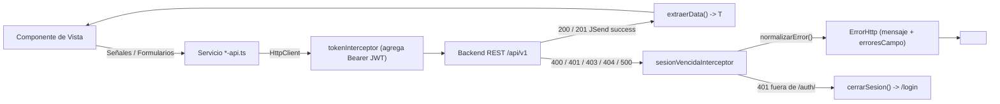

# Documentación Técnica del Frontend — Fast Work

Documentación modular de los componentes, servicios HTTP, reglas de dominio y enrutamiento de la aplicación web desktop **Fast Work** (cobertura única en **Trujillo, Perú**), alineada con la documentación de la API en [backend_docs/modulos](../backend_docs/modulos/README.md).

---

## 1. Información General y Stack Tecnológico

| Concepto                   | Valor                                                                                |
| :------------------------- | :----------------------------------------------------------------------------------- |
| **Framework**              | Angular `^21.2.0` (`standalone` por defecto, `ChangeDetectionStrategy.OnPush`)       |
| **Formularios**            | Signal Forms (`@angular/forms/signals`: `form`, `FormField`, `submit`, `applyEach`)  |
| **Estado Reactivo**        | Angular Signals (`signal`, `computed`, `effect`, `input`, `output`, `model`)         |
| **URL Local Frontend**     | `http://localhost:4200`                                                              |
| **Backend Consumido**      | `http://localhost:8081/api/v1` (`environment.apiUrl`)                                |
| **Alcance Visual**         | Web Desktop (`min-width: 1024px` en `src/styles.css`), sin segmentación por distrito |
| **Formato de Intercambio** | JSON bajo estándar **JSend** (`success`, `fail`, `error`)                            |

---

## 2. Arquitectura de Carpetas (`src/app/`)

```text
src/app/
|-- app.ts / app.html / app.css       # Shell raíz (<app-barra-navegacion /> + <router-outlet />)
|-- app.config.ts                     # Router con withComponentInputBinding() y HttpClient con interceptores
|-- app.routes.ts                     # Rutas con lazy loading, sesionGuard, rolGuard e invitadoGuard
|-- dominio/                          # Modelos de dominio e invariantes puras (auth, rol, oficio, proveedor, solicitud, mensaje, resena, piloto)
|-- core/
|   |-- api/                          # Contrato JsendResponse, extraerData y normalizarError -> ErrorHttp
|   |-- auth/                         # AuthApi (estado JWT), tokenInterceptor, sesionVencidaInterceptor, guards
|   `-- layout/                       # BarraNavegacion, CalificacionEstrellas, BadgeEstado, AlertaMensaje, ModalConfirmacion
|-- auth/                             # Módulo 1: Login, Registro
|-- oficio/                           # Módulo 2: OficioApi, ListaOficios, FormularioOficio
|-- proveedor/                        # Módulo 3: ProveedorApi, ListaProveedores, TarjetaProveedor, DetalleProveedor, FormularioProveedor
|-- solicitud/                        # Módulo 4: SolicitudApi, FormularioSolicitud, ListaSolicitud, TarjetaSolicitud
|-- mensaje/                          # Módulo 5: MensajeApi, ChatSolicitud
|-- resena/                           # Módulo 6: ResenaApi, FormularioResena, ListaResenas
|-- admin/                            # Módulo 7: AdminApi, VerificacionProveedores, ResumenPiloto
`-- piloto/                           # Módulo 8: PilotoApi, EncuestaPiloto
```

---

## 3. Flujo de Comunicación y Manejo de Errores



---

## 4. Mapa de Rutas (`src/app/app.routes.ts`)

| Ruta                                   | Componente Destino                               | Carga | Guards Aplicados                                  |
| :------------------------------------- | :----------------------------------------------- | :---- | :------------------------------------------------ |
| `''`                                   | Redirección a `directorio` (`pathMatch: 'full'`) | —     | —                                                 |
| `login`                                | `Login`                                          | Lazy  | `invitadoGuard`                                   |
| `registro`                             | `Registro`                                       | Lazy  | `invitadoGuard`                                   |
| `directorio`                           | `ListaProveedores`                               | Lazy  | `sesionGuard`                                     |
| `proveedores/:idPerfilProveedor`       | `DetalleProveedor`                               | Lazy  | `sesionGuard`                                     |
| `proveedor/perfil`                     | `FormularioProveedor`                            | Lazy  | `sesionGuard`, `rolGuard('PROVEEDOR')`            |
| `solicitudes`                          | `ListaSolicitud`                                 | Lazy  | `sesionGuard`, `rolGuard('CLIENTE', 'PROVEEDOR')` |
| `solicitudes/nueva/:idPerfilProveedor` | `FormularioSolicitud`                            | Lazy  | `sesionGuard`, `rolGuard('CLIENTE')`              |
| `piloto`                               | `EncuestaPiloto`                                 | Lazy  | `sesionGuard`, `rolGuard('CLIENTE', 'PROVEEDOR')` |
| `admin/verificaciones`                 | `VerificacionProveedores`                        | Lazy  | `sesionGuard`, `rolGuard('ADMIN')`                |
| `admin/oficios`                        | `ListaOficios`                                   | Lazy  | `sesionGuard`, `rolGuard('ADMIN')`                |
| `admin/piloto`                         | `ResumenPiloto`                                  | Lazy  | `sesionGuard`, `rolGuard('ADMIN')`                |
| `**`                                   | Redirección a `directorio`                       | —     | —                                                 |

---

## 5. Índice de Documentación por Módulo (`docs/frontend_docs/modulos/`)

|  #  | Módulo                         | Documento                                              | Componentes y Servicios Documentados                                                                                                                               |
| :-: | :----------------------------- | :----------------------------------------------------- | :----------------------------------------------------------------------------------------------------------------------------------------------------------------- |
|  0  | **Núcleo y Layout Compartido** | [00-core-y-layout.md](./modulos/00-core-y-layout.md)   | `App`, `jsend.ts`, `errores.ts`, `AuthApi`, interceptores, guards, `BarraNavegacion`, `CalificacionEstrellas`, `BadgeEstado`, `AlertaMensaje`, `ModalConfirmacion` |
|  1  | **Autenticación**              | [01-autenticacion.md](./modulos/01-autenticacion.md)   | `Login`, `Registro`                                                                                                                                                |
|  2  | **Catálogo de Oficios**        | [02-oficios.md](./modulos/02-oficios.md)               | `OficioApi`, `ListaOficios`, `FormularioOficio`                                                                                                                    |
|  3  | **Directorio y Proveedores**   | [03-proveedores.md](./modulos/03-proveedores.md)       | `ProveedorApi`, `ListaProveedores`, `TarjetaProveedor`, `DetalleProveedor`, `FormularioProveedor`                                                                  |
|  4  | **Solicitudes y Agenda**       | [04-solicitudes.md](./modulos/04-solicitudes.md)       | `SolicitudApi`, `FormularioSolicitud`, `ListaSolicitud`, `TarjetaSolicitud`                                                                                        |
|  5  | **Mensajería Interna**         | [05-mensajeria.md](./modulos/05-mensajeria.md)         | `MensajeApi`, `ChatSolicitud`                                                                                                                                      |
|  6  | **Calificaciones y Reseñas**   | [06-resenas.md](./modulos/06-resenas.md)               | `ResenaApi`, `FormularioResena`, `ListaResenas`                                                                                                                    |
|  7  | **Administración**             | [07-administracion.md](./modulos/07-administracion.md) | `AdminApi`, `VerificacionProveedores`, `ResumenPiloto`                                                                                                             |
|  8  | **Métricas del Piloto**        | [08-piloto.md](./modulos/08-piloto.md)                 | `PilotoApi`, `EncuestaPiloto`                                                                                                                                      |
